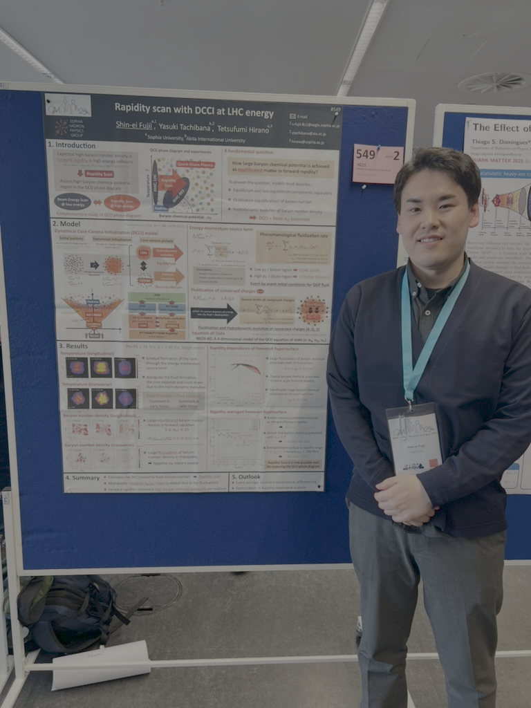

::: {.profile}

::: {.profile-intro}
## Theoretical nuclear physicist PhD in Physics {.unnumbered}

I am a postdoctoral fellow at the Zhejiang Institute of Modern Physics,
Department of Physics, Zhejiang University, China.

[Publications](publications.qmd){.btn .btn-outline-primary}
[Presentations](presentations.qmd){.btn .btn-outline-primary}
[Career & Education](about.qmd){.btn .btn-outline-primary}
:::
:::

## Research Interests

- Relativistic heavy-ion collisions and the quark-gluon plasma
- Relativistic hydrodynamics and hydrodynamic fluctuations
- Dynamical core-corona initialization
- Spin polarization and vorticity in low energy heavy-ion collisions

## Links

- [INSPIRE-HEP](https://inspirehep.net/authors/2712176)
- [Google Scholar](https://scholar.google.co.jp/citations?hl=ja&user=8KENchAAAAAJ)
- [ORCID](https://orcid.org/0009-0004-8735-5214)
- [researchmap](https://researchmap.jp/Shin-ei0805)
- [arXiv](https://arxiv.org/search/?query=Fujii%2C+Shin-ei&searchtype=author&abstracts=show&order=-announced_date_first&size=50)
- [GitHub](https://github.com/ShineiFujii)
- [Homepage(Japanese)](https://sites.google.com/view/shinei-homepage?pli=1&authuser=0)

## Contact

Email: `s-fujii-8c2_at_eagle.sophia.ac.jp`\
Please replace `_at_` with `@` when sending an email.